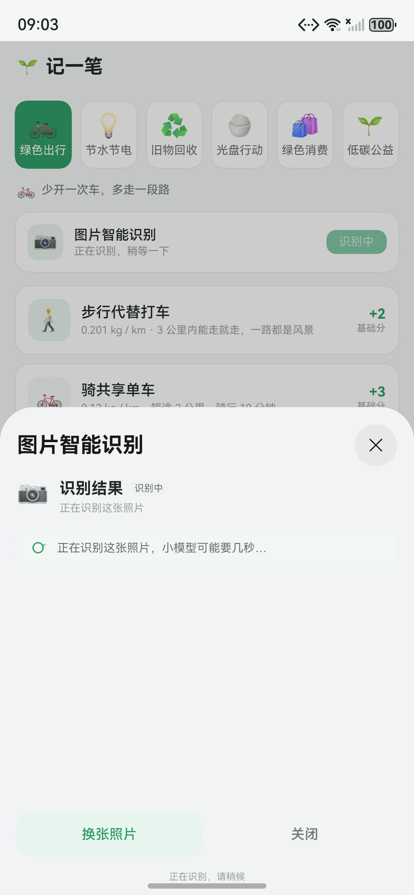
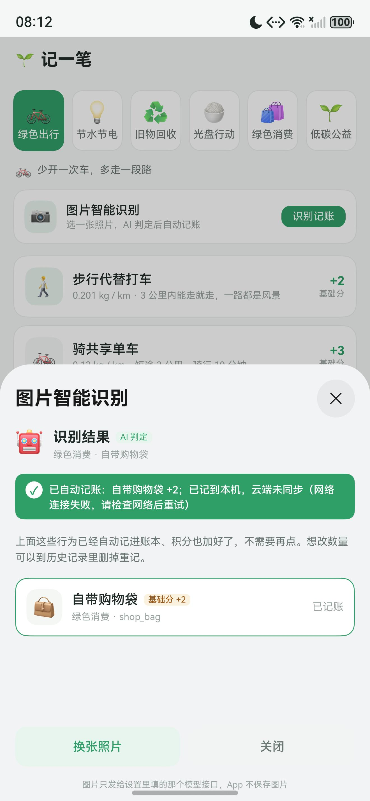
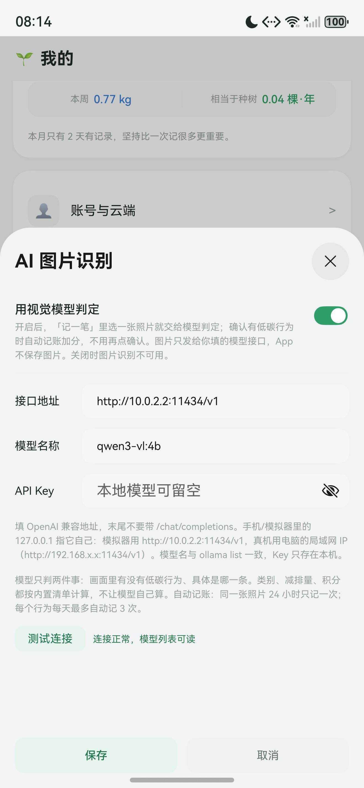
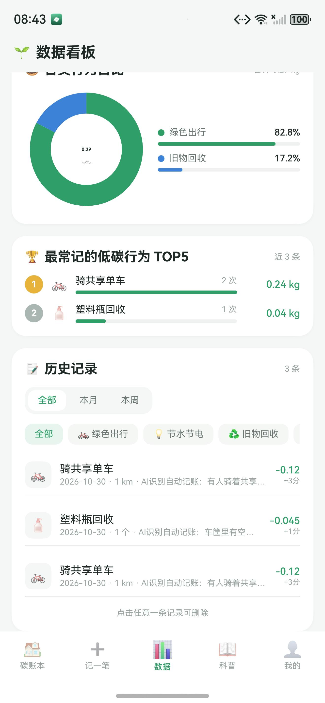
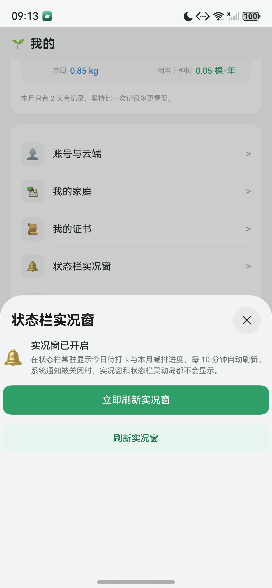
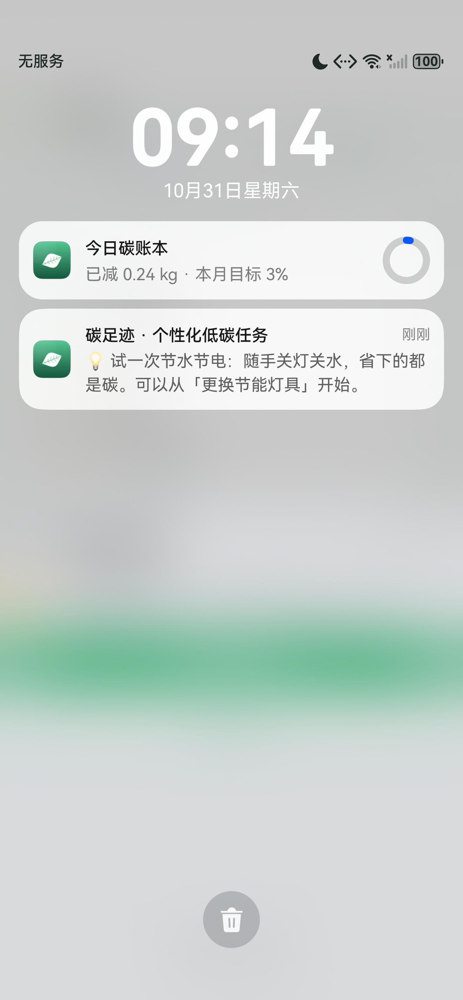
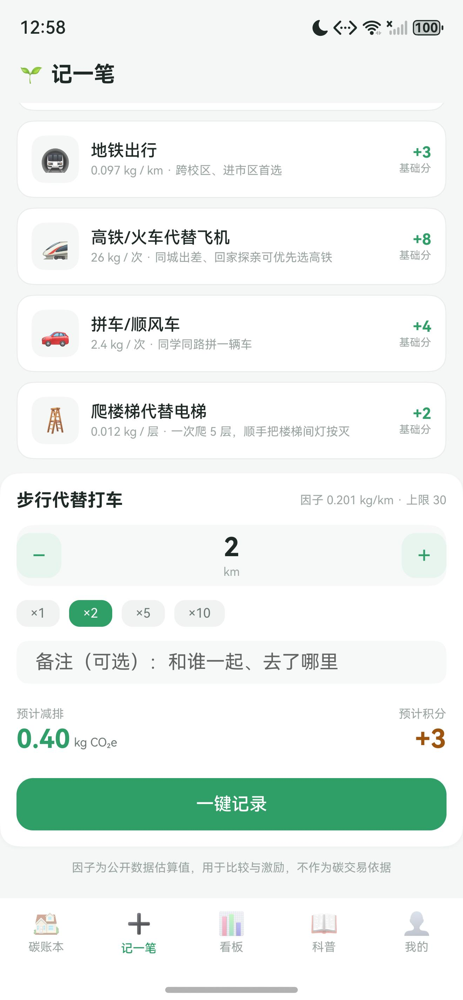
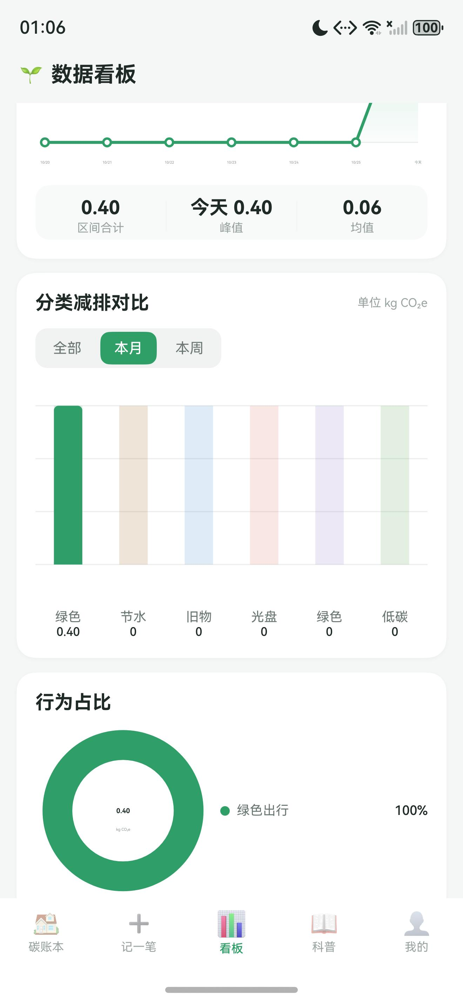
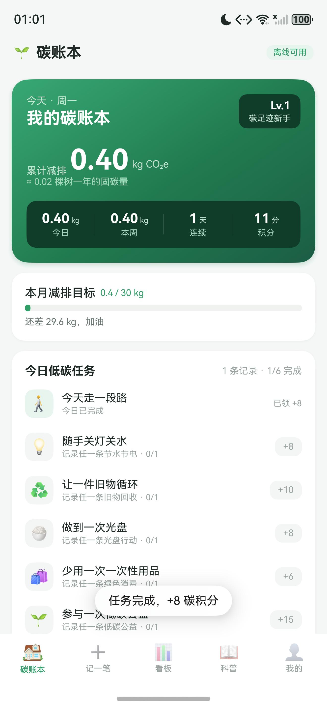
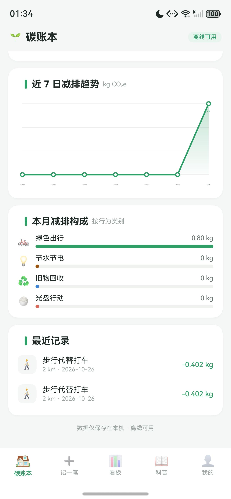

# 碳足迹 · 全民绿色生活碳积分与减排指南

第三届河南省高等学校信息技术应用创新大赛（开源鸿蒙）**赛题二**参赛作品。

基于 HarmonyOS / ArkTS（Stage 模型）。账号体系走自建后端（Supabase），登录后云端同步；
未登录时碳账本、看板、科普仍可离线使用，“我的”页除家庭入口外为登录引导页。

> 技术文档：[docs/碳足迹_技术文档_v1.0.docx](docs/碳足迹_技术文档_v1.0.docx)（35 页，含架构、数据模型、
> 算法、构建部署与验证记录）。文档里的数值直接解析源码生成，改完代码可用
> `python tools/build-tech-doc.py` 重新生成，避免文档与实现脱节。

---

## 零、五分钟跑起来（复现演示效果）

先讲这台开发机上唯一的坑：**模拟器的应用层解析不了域名**——系统 `ping 域名` 正常（内核走
`/etc/resolv.conf` 里的 114.114.114.114），但 App 的 HTTP 栈（netstack）用的是 DHCP 下发的
`10.0.x.x` 那个不响应的 DNS，于是登录、家庭、云同步一律
`{"code":2300006,"message":"Couldn't resolve host name"}`。系统自己的华为账号服务也报同样的错，
所以不是本项目的问题，也不是 Supabase 的问题。

**真机、或网络正常的模拟器没有这个毛病，走路线 A 就行。**

### 路线 A：真机 / 网络正常

```cmd
tools\run.cmd -All                        :: 已连接的全部设备各装一遍
tools\run.cmd -Device 127.0.0.1:5555      :: 只装指定那台
```

### 路线 B：本机模拟器（需要一条本机中转）

```cmd
tools\dev-proxy.cmd on        :: 起代理 + 把 SUPABASE_URL 切到 http://10.0.2.2:8787 + 重装
```

成功时会打印：

```
代理已启动（pid 12345，监听 8787）
代理自检通过（HTTP 401，能连到 Supabase）
安装成功，启动 com.example.harmony03/EntryAbility
```

原理：`10.0.2.2` 是模拟器眼中的"宿主机"，这条链路不需要 DNS。请求先到本机的
`tools/dev_proxy.py`（只听 8787），再由本机（DNS 正常）转发到
`https://hfumlfksryyzaebiuaca.supabase.co`。**数据仍写在同一个 Supabase 项目里，不是另一套后端。**

> 代理是独立进程，关掉那个 cmd 窗口不影响；但**重启电脑后要重新执行一次 `on`**。

### 演示剧本：两个人组建家庭（约 2 分钟）

准备：两台设备（模拟器或真机）各登录一个账号。没有账号就点「还没有账号？注册一个」，
填用户名（3-32 位字母数字）、密码（≥6 位）、昵称。

| 步骤 | 在 A 设备上 | 在 B 设备上 |
|---|---|---|
| 1 | 我的 → 我的家庭 → 搜索框输入 B 的**用户名** | 停在任意页面，**别切后台** |
| 2 | 点搜索结果 → 确认「是否邀请『XX』加入家庭」 | — |
| 3 | 页面上出现「已发出的邀请 · 等待同意」 | **≤3 秒**，顶部弹出「家庭邀请」卡片，底部有 4 秒倒计时条 |
| 4 | 等对方处理 | 三选一：点**同意** → 提示「已加入家庭」并自动进家庭页；点**取消** → 卡片消失，但邀请还在家庭页收件箱里可手动同意；点**卡片正文** → 直接跳家庭页 |
| 5 | 回到家庭页刷新，看到两名成员 | 家庭页显示「2/6 位成员」、创建者、8 位邀请码 |

细节：

- 同一条邀请只弹一次（重启 App 会再提醒一次，当兜底）；
- 未登录、或已经有家庭时不轮询、不弹；
- 轮询间隔 3 秒，冷启动和从后台回前台会立刻查一次，所以正常情况下几乎感觉不到等待。

### 演示完记得还原

```cmd
tools\dev-proxy.cmd off       :: 地址改回 https://hfumlfksryyzaebiuaca.supabase.co 并重装
```

不还原的话，代码里留的是 `http://10.0.2.2:8787`，这份包换台电脑就跑不通了。

---

## 一、运行环境

| 项目 | 版本 |
|---|---|
| 开发工具 | DevEco Studio 6.0.1（安装路径 `D:/DevEco studio`；换成别的机器时改 `DEVECO_HOME` 即可） |
| SDK | HarmonyOS 6.0.1(21)，compatibleSdkVersion 6.0.1(21) |
| 语言 | ArkTS（Stage 模型） |
| 目标设备 | phone / tablet |
| 依赖 | 无第三方包，仅系统 Kit（ArkData、CoreFileKit、ArkTS、ArkUI、NotificationKit、BackgroundTasksKit、NetworkKit） |
| 权限 | `ohos.permission.INTERNET`（登录与云端同步） |

命令行构建（已验证可用）：
```bash
cd "D:/HarmonyOS/Harmony03-AI"
export DEVECO_SDK_HOME="D:/DevEco studio/sdk"
export PATH="/d/DevEco studio/tools/node:$PATH"
node "/d/DevEco studio/tools/hvigor/bin/hvigorw.js" \
  --mode module -p product=default -p buildMode=debug assembleHap --no-daemon
```

> `tools/run.ps1`、`tools/run.sh`、`tools/sign-hap.sh` 会自动按
> `D:/DevEco studio` → `D:/deveco-studio/DevEco Studio` → … 的顺序探测安装位置，
> 也可以用环境变量 `DEVECO_HOME` 显式指定。

批量检查（与 IDE 内预览前的检查为同一套工具，必须先清到 0 缺陷，否则预览器会以
`LINTER_CHECK_INTERCEPTION` 拒绝启动）：
```bash
"/d/DevEco studio/tools/node/node.exe" \
"/d/DevEco studio/plugins/codelinter/run/index.js" \
-c code-linter.json5 -f default .
```

产物：`entry/build/default/outputs/default/entry-default-unsigned.hap`

### 构建 + 签名 + 安装 + 启动（替代 IDE 的 Run 按钮）

**PowerShell（推荐）**：

```powershell
.\tools\run.ps1                          # 自动选设备；没设备会拉起模拟器
.\tools\run.ps1 -Device 127.0.0.1:5555   # 模拟器 + 真机同时连接时指定
.\tools\run.ps1 -All                     # 已连接的所有设备都装一遍
.\tools\run.ps1 -NoEmulator              # 没设备时不要自动启动模拟器
```

**CMD / Git Bash**：

```cmd
tools\run.cmd
```

```bash
bash tools/run.sh
```

> Windows 自带的 `bash` 是 WSL 启动器，未安装 WSL 发行版时会报
> `WSL (10 - Relay) ERROR: execvpe(/bin/bash) failed: No such file or directory`。
> 请用 `tools\run.cmd`，或在 Git Bash 里执行 `bash tools/run.sh`。

只做签名、不安装：

```bash
bash tools/sign-hap.sh        # 产物 dist/harmony03-signed.hap
```

> 签名材料与限制见 `signature/README.md`：本地用 OpenHarmony 根 CA 签的包模拟器/开发板可装，
> 零售版 HarmonyOS NEXT 真机需要华为签发的调试证书（DevEco 登录华为账号后自动签名）。


---

## 二、目录结构

```
entry/src/main/ets/
├── entryability/EntryAbility.ets     # 应用入口：初始化存储、文件服务、沉浸式窗口
├── pages/Index.ets                   # 主框架：5 个 Tab + 顶部标题栏
├── model/
│   ├── CarbonModels.ets              # 数据类型（行为、记录、徽章、任务、统计）
│   ├── CarbonData.ets                # 碳排放因子库（33 条行为）+ 徽章 + 每日任务
│   └── ArticleData.ets               # 双碳科普文章（10 篇）
├── viewmodel/
│   └── CarbonStore.ets               # 业务中心：记录增删、统计聚合、积分、徽章、备份
├── service/
│   ├── StorageService.ets            # preferences 键值持久化
│   ├── FileService.ets               # 沙箱文件读写（备份 / 报表导出）
│   ├── CloudAccount.ets              # 账号 + 云端同步（登录 / 记录 / 兑换 / 备份 / 清空）
│   ├── CityService.ets               # 城市碳普惠绑定
│   ├── FamilyService.ets             # 家庭减碳：搜人 / 邀请 / 同意 / 退出 / 解散（Supabase RPC）
│   ├── FamilyInviteWatcher.ets       # 家庭邀请提醒：前台 3 秒轮询 + 去重，交给 Index 弹卡片
│   ├── InsightService.ets            # 个性化推荐规则
│   ├── NotificationService.ets       # 定时提醒 + 实况窗 + 通知深链（wantAgent）
│   ├── AIRecognitionService.ets      # 视觉模型调用（OpenAI 兼容，本地千问/ollama）
│   ├── ImageRecognitionService.ets   # 选图、AI 判定转候选（端侧色彩兜底已删除）
│   ├── AutoRecordPolicy.ets          # 自动记账策略（同图去重 / 日上限，纯函数）
│   └── AutoRecordService.ets         # 图片指纹 + 台账 + 本地/云端落库
├── components/
│   └── Charts.ets                    # 自绘图表：折线面积图、柱状图、环形图（Canvas + 绘制类）
├── common/
│   ├── Theme.ets                     # 配色常量
│   ├── Utils.ets                     # 日期、格式化、CSV 转义等纯函数
│   ├── Widgets.ets                   # 跨页复用：EmptyBox / ProgressLine / SectionTitle
│   ├── InviteAlert.ets               # 邀请提醒的纯规则：弹不弹、弹哪条、文案怎么写
│   └── DialogUtil.ets                # 弹窗封装（UIContext 新接口）
└── view/
    ├── HomeTab.ets                   # 碳账本：总览、目标、任务、趋势、构成、最近记录
    ├── RecordTab.ets                 # 记一笔：分类 → 行为 → 数量 → 备注 → 即时试算
    ├── ChartTab.ets                  # 数据看板：日/周/月/年趋势、柱状、环形、排行、历史
    ├── LearnTab.ets                  # 双碳科普：搜索、栏目、详情页
    └── MineTab.ets                   # 我的：等级、复盘、徽章、兑换、证书、家庭、分享、设置、备份
```

代码规模约 1.86 万行（39 个 .ets 文件，含空行与注释）。工程根目录另含：
`tools/verify-logic.mjs`（开发期业务回归脚本，48 条用例，不参与 HAP 构建）、
`supabase/schema.sql`（账号与记录表的 RPC 定义）、`supabase/family.sql`（家庭三表 + 12 个 RPC）、
`tools/run.*` 与 `tools/sign-hap.sh`（构建/签名/安装/启动）、`tools/dev-proxy.*` + `tools/dev_proxy.py`
（模拟器联调用的本机中转，见第零节）。

---

## 三、功能与赛题要求对照

赛题二要求五项主要功能 + 四项创新拓展：

| 赛题要求 | 实现位置 | 说明 |
|---|---|---|
| 1. 低碳行为核算 | `RecordTab` + `CarbonData` | 6 大类 33 条行为，内置碳排放因子，自动算减排量，可调数量 |
| 2. 数据可视化看板 | `ChartTab` | 折线（日/周/月/年四维）、柱状（分类对比）、环形（占比）、行为 TOP5 |
| 3. 碳积分激励体系 | `MineTab` + `CarbonStore` | 每日任务领积分、成就徽章 10 枚、可兑换徽章证书 8 项、等级成长 |
| 4. 双碳科普专栏 | `LearnTab` + `ArticleData` | 10 篇图文，3 个栏目，支持关键词搜索，详情页含"划重点" |
| 5. 本地数据管理 | `StorageService` + `FileService` | preferences 持久化、CSV 报表导出、JSON 备份与一键恢复 |

创新拓展：

- **本地备份与恢复**：写入应用沙箱 `filesDir`，无需存储权限，可在"我的 → 数据管理"一键恢复。
- **月度复盘**：本月 vs 上月环比、活跃天数、最佳分类、单次最高减排记录、个性化提示。
- **统计分析**：连续打卡天数、等级体系（Lv.1~Lv.10）、等效植树量、月度目标进度。
- **图片识别自动记账**：接本地部署的千问等 OpenAI 兼容视觉模型，选一张照片即由模型判定
  低碳行为并自动入库加分，用户不需要点选候选、也不需要点"一键记录"（见 4.6）。

> 赛题允许"云端同步、多设备"作为加分项而非必做。本作品两者都做了：未登录时是完整的单机版
> （本地 preferences + CSV 导出 + JSON 备份恢复），登录后叠加自建 Supabase 账号体系、云端同步、
> 家庭减碳、电子证书与实况窗提醒。

---

## 四、关键设计

### 1. 碳排放因子

统一单位 `kgCO2e`，取值参考生态环境部公开指南、IPCC AR6、行业公开研究，为**常识性估算值**，用于比较与激励，不作为碳交易依据。每条行为都带 `factorFrom` 字段写明来源口径，界面可查看。

### 2. 积分规则

```
积分 = 基础分 + 减排量(kg) × 2，向上取整，最低 1 分
```

高减排量的行为得分更高，避免"只刷简单行为"。

### 3. 状态管理

- 数据层为全局单例 `carbonStore`
- 写入后调用 `bumpDataVersion()` 递增 `AppStorage` 中的 `carbonVersion`
- 主页面 `@StorageLink + @Watch` 收到变化，递增各 Tab 的 `token`
- 子页面 `@Prop @Watch('onTokenChange')` 触发重新取数

> 采用这层间接，是因为 `@StorageLink` 只能感知首层赋值，直接传对象容易出现"记完账首页不刷新"。

### 4. 图表实现

未引入第三方图表库（保证离线、零依赖），全部用 Canvas 自绘：

- `LineChart`：带渐变面积、数据点、峰值标注、X 轴标签抽稀
- `BarChart`：圆角柱 + 底槽 + 数值标注
- `RingChart`：环形分段 + 中心文字，无数据时显示占位

三者均实现为「`@Builder` + 独立绘制类（`LinePainter`/`BarPainter`/`RingPainter`）」，
不是自定义组件。原因是 CodeLinter 的 `@performance/avoid-overusing-custom-component-check`
会提示纯画布结构不必做成组件，而且这样还能免掉 `@Prop` 数组的深拷贝。
绘制上下文（`RenderingContextSettings`/`CanvasRenderingContext2D`）由调用页面持有并传入，
因为 `@Builder` 内部不能 `new` 引用类型字段。

**踩过的坑（已修）**：`@Builder` 里的 `Canvas` 只在 `onReady` 和 `onAreaChange` 时绘制。
数据变了（比如切换"全部/本月/本周"）这两个回调都不会再触发，画面会一直停在旧图上，
用户感知就是"点了选项没反应"。所以：

- 数据变化的入口统一用 `@Watch` 监听（`dim`、`range`、父页面传入的 `token`），只改状态，由 `@Watch` 驱动 `refresh()`
- `refresh()` 末尾调用 `repaintLineChart` / `repaintBarChart` / `repaintRingChart` 主动重画
- 画布尺寸按**固定 key**（`home_line`、`chart_bar`…）缓存在 `Charts` 模块内，重绘时直接复用；
  不能再用"数据长度/版本"拼 key，否则重绘时查不到尺寸，图会画不出来
- 传给画布的 **数据用 provider 闭包**（`() => this.series`），不直接传数组：`@Builder` 的值参数
  会被长期缓存，`onAreaChange` 重画时会拿旧数组把新图覆盖回去
- Canvas 内容不会随滚动/切 Tab 自动保留，因此在图表容器上加 `onVisibleAreaChange`，
  重新可见时按当前数据补画；切 Tab 瞬间画布还不可见，再排一次 40ms 延迟重绘兜底
- `onAreaChange` 的高度在滚动中可能是 0 或裁剪值，缓存尺寸时只用有效宽度 + 调用方声明的固定高度
- 绘制器单例已 `export`，三个 `repaintXxx` 也一并导出，页面直接调用
- `BarPainter` 开头保留 `w <= 0 || h <= 0` 保护，因为 `onReady` 触发时画布可能还没测量完

> 同类问题还有一批：`ForEach` 的 key 如果不包含"界面依赖的状态"，ArkUI 会复用旧节点而不重新执行
> 子构建，表现同样是"点了不动"。分类高亮、历史筛选、任务进度、排行数值都踩过，现已把状态并入 key。

> **更隐蔽的两个坑（本轮模拟器走查发现，已修）**：
> - `@Component struct` 里不能写 TS 的 `get` 访问器。ets-loader 会把 `get selected()` 整个丢掉，
>   但保留 `this.selected` 的引用，运行时恒为 `undefined`。结果是「记一笔」的试算面板永远不渲染、
>   分类说明行空白。struct 内一律用普通方法（`currentActivity()`）取派生值，并加了静态守卫。
> - `@Builder` 的值参数只在构建时求值一次。`SegControl(DIMS, this.dim, ...)` 这种写法，
>   切换维度时高亮永远停在下标 0。状态必须写在属性表达式里直接读 `this.dim`，或把可变部分
>   做成 `@Component + @Prop`（进度条 `ProgressBar` 就是因此从 `@Builder` 改成的组件）。

### 5. 一致性与边界处理
- 删除记录后自动回收"不再达标"的每日任务奖励，保证积分账实一致
- 连续打卡：今天没记允许从昨天起算，不算断
- 周起点按周一计算（周日归上一周）
- 首次进入时存储尚未读完，各页面用 `ensureLoaded` 兜底刷新一次

### 6. 图片识别自动记账（识别完即入账，不用手点）

链路：`RecordTab` 选图 → `ImageRecognitionService.recognize()` → `AIRecognitionService`（OpenAI
兼容接口，指向本地部署的千问 / ollama）→ 命中则 `AutoRecordService.commit()` 直接落库。
识别一开始就弹出结果面板（"正在识别这张照片…"），识别完成后**面板不关**，顶部横幅给出结论：
绿色=已自动记账、黄色=没记上的原因，候选行标"已记账"。用户全程不需要点击。

- **模型只回两个值**：
  `{"hasLowCarbon":true,"activityId":"travel_bike"}` / `{"hasLowCarbon":false,"activityId":""}`。
  类别、行为名、单位、减排因子、积分全部按 `activityId` 从 `CarbonData` 查，模型不复述、
  不计算——既省 token，也不会出现"行为名写错""积分算错"。2B/4B 这类小模型也更容易照做。
- **积分口径**：与手动记账完全一致，`积分 = 基础分 + 减排量 × 2`（最低 1 分），基础分与
  减排因子都取自 `CarbonData` 里该行为的定义，不分自动/手动。
- **数量固定记 1 个计量单位**：模型只判"有没有这件事"，不判数量，替用户猜数量等于替用户编数据；
  想改数量可以在历史记录里删掉重记，或直接用「记一笔」手动录。
- **两道硬闸**（`AutoRecordPolicy.ets`，纯函数、可回归）：
  1. 同图去重：对图片做 9×8 灰度 dHash，同一指纹 24 小时内只记一次（改系统时间也绕不过）；
  2. 单行为日上限：同一行为每天最多自动记 3 次，防连拍同类照片刷分。
- **落库**：登录后先走 `cloudAccount.addRecord()`（Supabase `add_record` RPC）再写本地；RPC 失败
  时退回本机写入并在横幅里写明"已记到本机，云端未同步"——手动记账本来就能离线记，自动记账
  不该因为云端抖动就什么都不记。未登录在选图前就拦住并引导登录，绝不静默加分。
- **失败不打扰也不算成功**：模型没看出行为、格式不对、连不上、同图已记过、已达上限时，面板顶部
  用黄色横幅写清原因，候选仍可手动"补记"；"重试这张 / 换张照片"入口保留。
- **入口不说假话**：识别入口的副标题会随模型是否可用切换——可用时「选一张照片，AI 判定后自动记账」，
  不可用时「AI 未启用：请先在「我的 → 个人设置 → AI 图片识别」配置模型」。此前两种状态都写
  "自动记账"，用户选完图才发现要手点，属于承诺与实际不符（走查时真实踩到）。
- **可追溯**：自动记录的备注统一为 `AI识别自动记账：<行为名>`，历史列表与 CSV 报表里一眼可辨。
- **思考型小模型的兼容**（实测 `qwen3-vl:2b/4b`）：
  - 输出额度：思考容易吃满 `max_tokens`，正文为空或 JSON 被截断。首轮 2600、严格式重试 4000，
    并带 `reasoning_effort: low`（不支持该参数的网关会忽略）。
  - 超时：本地大模型单次 20~90 秒，`readTimeout` 放宽到 180 秒；超时与"连不上"分开报。
  - 结论捞取：模型常把推理和结论一起写进 `content` 且末尾被截断。只要文中出现带合法
    `activityId` 的 JSON（或明确 `hasLowCarbon:false`），就采信它，并记日志便于事后评估准确率；
    说 `true` 却给不出合法 id 的一律当"没识别出来"，绝不凭一句话加分。

> **端侧色彩候选已删除**：它是最早没接模型时的演示占位——按画面绿色/暖色占比猜"可能是植树、
> 可能是光盘"，既不准也不能自动记账，一条白墙照片会被判成"废纸回收 +3"。接入本地视觉模型后，
> 没有模型就不给结论：入口直接提示去配置，面板如实报"这次没识别出来"，绝不用猜测结果充数。

### 7. 配色与可读性

鸿蒙的 8 位色值是 **ARGB**（`#AARRGGBB`），不是 Web 常用的 `#RRGGBBAA`。
`#FFFFFF1F` 会被解析成"不透明的 `#FFFF1F`"——亮黄色，而不是 12% 白。
之前科普页搜索框整块发黄、绿色统计卡上的分隔线发黄，都是这个原因。
需要半透明白时应写 `#1FFFFFFF`（12% 白）、`#40FFFFFF`（25% 白）。

绿色渐变的统计卡上，**不要用半透明白做色块底**：对比度会随底色变化且不可控。
统计条用**不透明的深绿**压暗：

| 位置 | 用色 | 白字对比度 | 小字对比度 |
|---|---|---|---|
| 碳账本底部四格统计 | `#0F3D2A` | 12.20 | 7.58 |
| 碳账本等级标签 | `#0F3D2A` | 12.20 | — |
| 我的-统计栏、头像圈 | `#0F3D2A` | 12.20 | 7.58 |

橙色告警色 `Palette.warn` 定为 `#9C540F`（原 `#E8A33D` 在白底上只有 2.16，不达标）；
浅色底一律不用 `#FFF7E8`/`#FFF6E5` 这类浅黄，改用浅绿 `#E8F4EE` 或浅杏 `#FBEDD8`。

### 8. 家庭：邀请怎么变成对方屏幕上的一张卡片

数据模型是两张业务表 + 一张邀请队列：

| 表 | 一行代表 | 关键字段 |
|---|---|---|
| `families` | 一个家庭 | `id / name / owner_id / invite_code / created_at` |
| `family_members` | 一个家庭成员 | `family_id / user_id / role / joined_at`；`user_id` 唯一 → 一人只能在一个家庭 |
| `family_invites` | 一条待处理的邀请 | `inviter_id / invitee_id / family_id(可空) / status / expires_at` |

刻意**不采用"每个家庭建一张表"**：表由开发者一次性建好，用户只往里插行、查行，靠 `family_id`
区分；动态建表会把权限、迁移、并发全搞乱。`family_invites` 也不是多余的——邀请发生在"家庭还
不存在"的时候（组建型邀请的 `family_id` 为空），对方同意后才真正写入 `families` 和两条
`family_members`；没有这张表，对方换台设备登录就不知道有人邀请过他。

业务表一律关闭 RLS，只允许经 `SECURITY DEFINER` 的 RPC 访问，每次调用带 token 做身份校验
（`_session_user(p_token)`），统一返回 `{ok, code, message}` 信封，未登录直接 `unauthorized`。

**"对方收到弹窗"是怎么落地的**：接口没有推送通道，邀请只是表里新增的一行。客户端在
`FamilyInviteWatcher` 里（前台、已登录、尚未加入家庭时）每 3 秒调一次 `family_state`——一次 RPC
同时带回家庭、成员、收件箱、已发出——命中未提醒过的邀请就交给 `Index` 弹卡片：

| 交互 | 行为 |
|---|---|
| 弹窗本体 | 标题「家庭邀请」+ 邀请人 + 正文，底部 4 秒倒计时条，到点自动消失 |
| 同意 | 直接 `family_accept`，成功提示并跳家庭页 |
| 取消 | 只关浮层，**不等于拒绝**，邀请仍在家庭页收件箱里可手动同意 |
| 点卡片正文 | 跳家庭页手动处理 |

去重与节流：同一 `inviteId` 只弹一次；未登录或已有家庭时直接跳过，连请求都不发；冷启动和
从后台回前台会立刻补查一次。没有选 Realtime（WebSocket）的原因：需要在 Supabase 给该表开
实时发布（等于把全部邀请行暴露给 anon key），本机代理还要额外支持 WebSocket 升级，
对这个体量的场景收益不抵复杂度，而 3 秒轮询在演示中基本感知不到延迟。

---

## 五、验证情况

1. **编译**：`hvigorw clean` + `assembleHap` 全量重建 **BUILD SUCCESSFUL**，0 error
   （仅有"未配置签名"的构建提示）。
2. **静态检查**：CodeLinter **0 error**；仅 `HomeTab` 遗留 1 条既有的
   `reuse-date-instances-check` 性能提示，与本次改动无关。
3. **业务逻辑**：新增 `tools/verify-logic.mjs`，用 DevEco 自带的 TypeScript 把**真实源码**
   （`Utils`、`CarbonModels/CarbonData/ArticleData`、`CarbonStore`、`AutoRecordPolicy`）转译成 CommonJS，
   仅把 `StorageService` 换成内存桩、`AuthService` 换成就绪态的具名桩，在 Node 里跑回归断言，**48 组全部通过**。
   覆盖：减排/积分公式、补记日期的统计口径、连续打卡、日/周/月序列、分类聚合与筛选、
   任务领取与删除回滚、兑换与等级、月度复盘、汇总缓存失效、CSV 转义、备份恢复、
   损坏/过新/重复 id 备份、旧数据字段归一化、ID 索引、家庭缓存解析与汇总、断网降级、
   邀请提醒的弹窗规则（未登录/已有家庭不弹、同一条只弹一次、多条取第一条、两种文案），
   以及两条静态守卫：struct 内不得出现 `get` 访问器、8 位色值不得写成 `#FFFFFFxx`。
   运行方式：`node tools/verify-logic.mjs`（需要 `DEVECO_TS` 指向 IDE 自带的 `typescript.js`，脚本会按 `D:/HarmonyOS/...` 依次探测，路径不同时请显式指定）。
4. **模拟器走查（2026-10-26，`hdc` + `uitest` 坐标点击）**：已逐项跑通并截图核对：
   - 记一笔：分类切换 → 行为选中 → 试算面板（数量/倍数/备注/预计减排/积分）→ 一键记录；
   - 碳账本：统计四格、本月目标、任务完成态、**领 +8 后变「已领」且积分 3 → 11**、近期趋势；
   - 趋势图稳定性：上下滚动、切到看板再切回、杀进程重启后，近 7 日折线图与数据都保留
     （修复前滚动即消失、重启后记录清零）；
   - 看板：日/周/月/年切换时高亮、曲线、区间合计/峰值/均值同步变化；全部/本月/本周高亮切换；
     柱状/环形图在滚出屏幕再滚回后仍正常渲染；
   - 科普：关键词 `GHG` 过滤到 1 篇，点开详情后键盘自动收起、返回可关闭；
   - 我的：等级进度、本月复盘、徽章、统计随数据更新；
   - 数据管理：备份 → 清空 → 恢复后记录、积分、任务领取状态完全一致。
5. **签名与装机**：`signature/` 提供 OpenHarmony 根 CA 的离线签名材料，`tools/sign-hap.sh` 产出
   `dist/harmony03-signed.hap`（hap-sign-tool 验签通过）。已在模拟器（Mate 80 Pro Max，
   HarmonyOS 6.0.1(21)，x86_64）上 `hdc install` 安装并逐项走查通过；零售版 HarmonyOS NEXT
   真机需要华为签发的证书（DevEco 登录账号后自动签名），本包的签名只被模拟器/开发板信任。
6. **未完成的验证**：模拟器时钟不允许回拨（`date: Operation not permitted`），
   所以"分类对比"的区间筛选只验证了控件切换与 `refresh()` 触发，跨周/月的真实数据差异
   由 Node 断言中的 `categorySeries(range)` 覆盖。

### 家庭与邀请提醒走查（2026-11-02 / 11-03，模拟器）

- **后端**：`supabase/family.sql` 已执行；用两个临时账号把 7 个 RPC 全链路跑通——未登录 →
  `unauthorized`；按昵称搜人；发邀请；对方收件箱出现；重复邀请幂等；同意后建家庭（双方 uid 各一行）；
  发起方看到同一家庭；对方已在家庭 → `target_in_family`；房主解散后另一人回到无家庭。
  测试账号与数据已清理（`users` 回到 6 个真实账号，三张家庭表 0 行）。
- **客户端**：两台模拟器分别登录 A/B，搜索 → 邀请 → 收件箱同意 → 家庭首页（2/6 位成员、邀请码、
  成员角色）全部走通；之后补上"邀请到达时主动弹卡片"，用临时注入的演示数据截图核对布局
  （标题 / 正文 / 同意·取消 / 4 秒进度条），验证完已删除注入代码。
- **未做的**：真实双设备的"邀请 → 弹窗"端到端（需要模拟器联网，即第零节路线 B），
  以及 App 不在前台时的推送（当前设计为前台 3 秒轮询，杀进程收不到）。

### 图片识别自动记账走查（2026-10-30 / 10-31，模拟器）

四轮联调，界面、选图、落库全部走真实代码：
① 用可控的假模型（故意慢 4 秒、故意给低分）验证同图去重与多行为；
② 用本机真实的 `qwen3-vl:2b`（Ollama）跑主链路；
③ 删除端侧色彩候选后，用 `qwen3-vl:2b` / `qwen3-vl:4b` 复测，并抓模型原始回复定位格式问题；
④ 把协议收敛成"只回两个值"后，用 `qwen3-vl:4b` 实测同一批照片。

| 核对项 | 结果 |
|---|---|
| 识别期间 | 选完图立刻弹出「识别结果 · 识别中 / 正在识别这张照片，小模型可能要几秒…」，不再有空窗 |
| 真实模型（两值协议） | `qwen3-vl:4b` 约 8.5 秒返回 `{"hasLowCarbon":true,"activityId":"shop_bag"}`，面板顶部绿色横幅「已自动记账：自带购物袋 +2」，**全程 0 点击** |
| 类别与积分 | 面板副标题「绿色消费 · 自带购物袋」，候选行「基础分 +2」「绿色消费 · shop_bag」；积分按 `CarbonData` 计算 |
| 没有低碳行为 | 同一模型对风景照返回 `hasLowCarbon:false`，面板显示「未检测到低碳行为」，不记账 |
| 云端不可达 | 横幅追加「已记到本机，云端未同步（网络连接失败…）」，本机照常记账、不整轮放弃 |
| 同一张图再选一次 | 黄色横幅「这张照片 24 小时内已经记过账，没有重复加分」，记录数不变 |
| 未登录点「识别记账」 | 弹出「图片识别记账需要登录」，不会静默加分 |
| 测试连接 | 「连接正常，模型列表可读」 |
| 面板返回键关闭后再点同一入口 | 已修：`bindSheet` 补 `onDisappear` 复位 `showSheet`，修复前会点了没反应 |

| 识别期间的面板（真实模型） | 识别完成：横幅 + 已记账 |
|---|---|
|  |  |
| **AI 识别设置（两值协议，无多余开关）** | **历史里的自动记录与备注** |
|  |  |

> 走查用的假模型服务只在本机临时启动，不在仓库里；真实部署时把地址换成 `ollama` / `vLLM` 的
> `/v1` 即可（模型名与 `ollama list` 一致）。
>
> 联调时发现并修掉的问题：
> ① 云端 RPC 失败时自动记账整轮放弃（手动记账却能离线记）→ 改为退回本机写入；
> ② AI 超时静默回退到端侧候选，界面看不出区别，用户只会看到"要手点"→ 删除端侧兜底，
> 入口文案与实际能力对齐，失败时面板如实报错并提供「重试这张」；
> ③ 识别入口的 AI 状态在改完配置后不刷新 → 切 Tab 时重新读取配置；
> ④ `qwen3-vl:2b/4b` 是思考型模型：`max_tokens` 被思考吃满导致正文为空或 JSON 截断、
> 单次耗时超过 90 秒被判"连不上" → 放宽额度与超时、超时与断网分开报、从思考文本里捞结论；
> ⑤ 模型要求它输出的字段越多越容易跑偏（多条数组 + confidence + evidence 时 2B 经常复读、
> 4B 偶发截断）→ 协议收敛为两个值，类别/分值全部本地查表；
> ⑥ 云端不可达时仍显示成功 → 横幅明确写出"已记到本机，云端未同步"。

### 实况窗 / 状态栏灵动岛走查（2026-10-31，模拟器）

实况窗与状态栏胶囊都挂在系统通知上：**通知权限一关，两者都不显示**，而且用户此前点过
"不允许"之后，`requestEnableNotification` 只会返回 `1600004`，系统不再弹授权框——旧版本
在这里是死路（点「开启实况窗」只提示"请在系统弹窗中允许通知"，但根本没有弹窗）。

| 核对项 | 结果 |
|---|---|
| 通知被拒绝时的日志 | `requestEnableNotification failed: {"code":1600004}` + `notification disabled, auto push not started` |
| 恢复路径 | 「我的 → 状态栏实况窗」新增「去系统设置」入口，调用 `notificationManager.openNotificationSettings()` 直达本应用的「通知管理」页 |
| 打开开关后 | 重启应用日志变为 `periodic task published` / `auto push started` / `work scheduler registered` |
| 实况窗卡片 | 下拉通知栏可见「今日碳账本 · 已减 0.24 kg · 本月目标 3%」+ 进度环 |
| 状态栏胶囊 | 状态栏左侧出现绿色实况胶囊（灵动岛） |
| 顺手修掉 | ①「刷新实况窗」过去无论成败都提示"已刷新"→ 按真实结果提示；② 从系统设置返回后状态不刷新 → 打开面板时重新读取权限；③ 面板文案补充"通知关闭时两者都不显示" |

| 实况窗面板（已开启） | 通知栏里的实况窗卡片 |
|---|---|
|  |  |

### 模拟器走查截图（2026-10-26）

| 记一笔 · 试算面板 | 看板 · 分段控件与占比 |
|---|---|
|  |  |
| **领任务后积分 3 → 11** | **备份 → 清空 → 恢复** |
|  |  |

滚动 / 切 Tab / 重启后趋势图仍保留：



### 预览器打不开的排查结论（备忘）

现象：点预览后一直停在"正在编译"，日志里是

```
current file preview is intercepted by linter check: Preview check failed.
preview state changed to: LINTER_CHECK_INTERCEPTION
```

而编译本身是 `COMPILE_SUCCEED`。根因是预览流程编译成功后会再跑一次 CodeLinter，
**只要有任何 warn 就拦截**。已按下面几项清干净：

| 原告警 | 处理 |
|---|---|
| `start-window-icon-check`：启动图标 1024×1024 超限 | 缩到 256×256 |
| `avoid-overusing-custom-component-check` × 6（CardBox/EmptyBox/SectionTitle、三个图表、ArticleDetail） | 纯展示结构改为 `@Builder`；卡片样式改为文件内 `@Styles` |
| `hp-arkui-no-state-var-access-in-loop`（折线图循环里读 `this.accent`） | 绘制逻辑搬进独立绘制类，先把状态读进局部常量 |
| `LearnTab` 自身（带 `@State`，必须用 `@Component`） | 该规则对本场景属误报，在 `code-linter.json5` 中关闭 |

> 注意：不同版本的 DevEco Studio 自带不同版本的 codelinter，告警集合会有差异
> （新版会多报 `@Styles` 导出、`@Builder` 参数等规则）。本机当前只有一套
> `D:/DevEco studio`，以它跑出来的结果为准；换机器时如果预览被拦截，先用
> 该机器 IDE 自带的 `plugins/codelinter/run/index.js` 重跑一遍。

---

## 六、本次缺陷修复与优化

### 1. 修复的缺陷

| # | 现象 | 根因 | 修复 |
|---|---|---|---|
| 1 | 切换日/周/月/年或全部/本月/本周后，图表停在旧数据 | `ChartTab.repaint()` 是空实现；Canvas 只在 `onReady`/`onAreaChange` 绘制，状态变化不会重放绘制命令 | `Charts.ets` 新增 `repaintLineChart/BarChart/RingChart`，按固定 key 缓存画布尺寸，`refresh()` 末尾主动重绘 |
| 2 | 新增记录后首页「近 7 日趋势」不更新 | 画布 key 用"数据条数"拼，重绘时查不到尺寸，`onReady` 又不会重触发 | 使用固定 key `home_line`，`refresh()` 主动重绘 |
| 3 | 分类高亮、历史筛选、任务进度、TOP5 数值"点了/记了不动" | `ForEach` 的 key 未包含界面依赖的状态，ArkUI 复用旧节点、不再执行子构建 | 相关 key 全部并入状态值（进度、高亮、数值、比例） |
| 4 | 记一笔的 ×5/×10 可超过行为数量上限（如高铁上限 4 次） | 快捷倍数未按 `maxQty` 截断 | 只渲染不超过上限的档位，点击与保存前各再 clamp 一次 |
| 5 | 补记历史日期后，今日/本周/本月与连续打卡、列表互相矛盾 | 统计按写入时间 `time` 聚合，列表与连续打卡按业务日期 `date` | 统一按 `date` 聚合（`recordDay()`）；补记时把 `time` 平移到那一天 |
| 6 | 在首页领任务奖励会把「记一笔」已选行为与数量重置 | `onTokenChange` 直接调 `pickDefault()` | 改为 `syncSelection()`，只在选择失效时校正 |
| 7 | 任务领取 key 只增不减，长期使用会无限增长 | 领取后从不清理 | 读取、领取、回滚时清理非今日 key（奖励已入账，不影响账目） |
| 8 | 损坏/版本过新的备份可能恢复出半套数据；重复 id 会破坏列表复用 | 无版本、结构、去重校验 | 版本上限校验、字段归一化、重复 id 重新生成 |
| 9 | 文件读写异常时 fd 泄漏；读取内容可能带尾部乱码 | 异常路径未 `closeSync`，按 `stat.size` 全量解码 | `finally` 关闭句柄；按 `readSync` 实际字节数解码 |
| 10 | `Index` 里的 `load()` 失败会产生未捕获的 Promise 拒绝 | 未接 `.catch` | 显式捕获并写 hilog |
| 11 | 「记一笔」试算面板永远不出现、分类说明行空白 | `@Component struct` 内的 `get selected()` 被 ets-loader 丢弃，`this.selected` 恒为 `undefined` | 改成普通方法 `currentActivity()` / `currentCatIcon()`，并加静态守卫防回归 |
| 12 | 看板的日/周/月/年、全部/本月/本周点了只变图不变高亮，统计数字也不刷新 | `@Builder` 的值参数只在构建时求值一次；`SegControl(DIMS, this.dim, …)` 把状态当参数传入 | `SegControl` 改为只接收常量 `kind`，属性里直接读 `this.dim/this.range`；`StatPill`/`MiniStat`/`HeadStat` 同理改为按 `kind` 在方法里取状态 |
| 13 | 科普搜索框整块发黄、绿色统计卡分隔线发黄 | 8 位色值按 `#RRGGBBAA` 写，鸿蒙实际按 ARGB 解析，`#FFFFFF1F` 成了不透明的黄色 | 改为 `#1FFFFFFF` / `#40FFFFFF`，并加静态检查禁止 `#FFFFFFxx` |
| 14 | 顶部标题与状态栏时间/信号图标重叠 | 开启 `setWindowLayoutFullScreen(true)` 却没给页面补安全区内边距 | 关闭全屏布局，并把状态栏/导航栏配色设为页面底色 |
| 15 | 搜索或备注输入后打开详情/保存，键盘仍遮住页面 | 输入框焦点未释放 | 打开详情、选中行为、保存时 `getFocusController().clearFocus()` |
| 16 | 近 7 日趋势图一滚动就消失、切 Tab 后空白 | Canvas 内容不随滚动保留；`onAreaChange` 滚动中上报 0/裁剪高度，把尺寸缓存写成 0；`@Builder` 值参数让画布回调一直用旧数组覆盖新图 | 只缓存有效宽度、高度用固定值；画布数据改为 **provider 闭包**实时取；`onVisibleAreaChange` + 40ms 延迟重绘兜底 |
| 17 | 杀进程重启后记录、积分、任务领取状态全部丢失 | `UIAbility.onCreate` 是异步的、框架不会 await；`loadContent` 先执行，`CarbonStore.load()` 在 preferences 就绪前读到空串并把 `loaded` 置真 | 把 `init/load` 移到 `onWindowStageCreate` 的 `bootstrap()`，等加载完再 `loadContent`；`CarbonStore` 增加 `storage.isReady` 守卫 |

### 2. 结构与性能优化

| 项 | 优化前 | 优化后 |
|---|---|---|
| 汇总统计 | `MineTab` 一次渲染里 `getSummary()` 被调 4 次以上，每次都扫全量记录 | 按数据版本缓存，所有写操作统一 `invalidate()` |
| 月度复盘 | `monthReduction`/`monthActiveDays`/`bestCategory`/`bestRecord` 各扫一遍；页面里 `bestCategory(0)` 调 4 次 | `monthReview()` 一趟遍历算完，页面只读 `MonthReview` |
| 倒序列表 | 每次 `allRecordsDesc()` 都复制 + 排序 | 缓存排序结果，写入时失效 |
| ID 查询 | `filter(...)[0]` 线性查找 | 构造期建立 `Map` 索引；新增 `iconOf()` 统一图标取法 |
| 等级 | 阈值表在业务层与 `MineTab` 各维护一份 | 阈值/称号收敛到 `CarbonData`，返回 `LevelInfo` 对象，替代 `string[]` 下标约定 |
| 重复 UI | `emptyBox` 抄 4 份、`ProgressLine` 抄 2 份、`sectionTitle` 抄 1 份 | 抽到 `common/Widgets.ets`；进度条改为 `@Component + @Prop` 的 `ProgressBar`，数据变化能真正刷新 |
| 备份状态 | 每次数据变化都读取并 parse 整个备份文件 | 只在进入页面、备份、恢复后刷新 |
| 搜索/筛选 | `filtered()` 每次 build 调 2 遍 | `@Watch` 驱动一次过滤，结果存入 `@State` |
| 记录备注 | 数据层有 `note` 字段，但 UI 无入口，报表该列永远为空 | 「记一笔」增加备注输入 |
| CSV | 只替换逗号，引号与换行未转义 | `csvCell()` 按 RFC4180 转义 |
| 死代码 | `showSheet`、`barLabels/barValues/barColors`、`catColor`、`levelProgress`、`analogize` 等 | 删除 |

### 3. 可复现的回归脚本

`tools/verify-logic.mjs` 直接转译仓库源码执行，不复制算法，避免"测的是另一份实现"。
需要 DevEco 自带的 TypeScript，可用 `DEVECO_TS` 指定路径：

```bash
node tools/verify-logic.mjs
# 或：DEVECO_TS="D:/.../typescript/lib/typescript.js" node tools/verify-logic.mjs
```

---

## 七、后续可做的事

- 配置签名后装真机，录 5 分钟演示视频
- 用本项目的 `ChartTab`、`HomeTab` 截图制作 PPT
- 按赛事要求写《设计方案》Word 文档（宋体小四、1.5 倍行距，正文不得出现校名队名）
- 图片识别已接入本地视觉模型并自动记账（见 4.6），可以补一段"同一张图连选两次只加一次分"的演示
